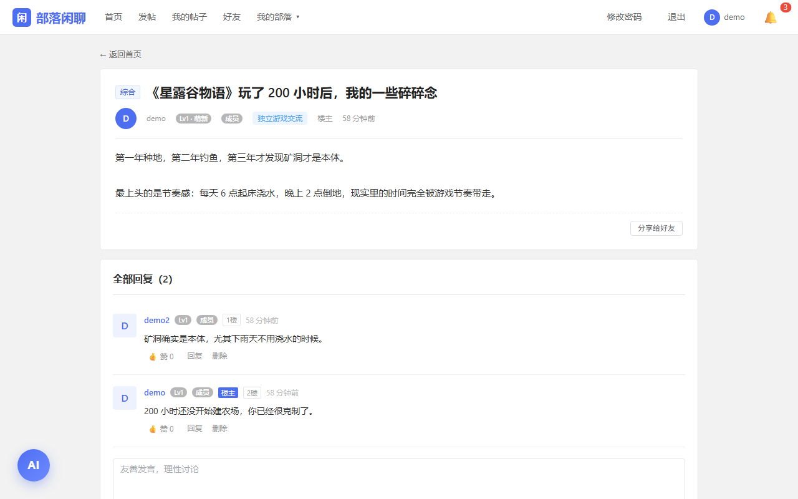
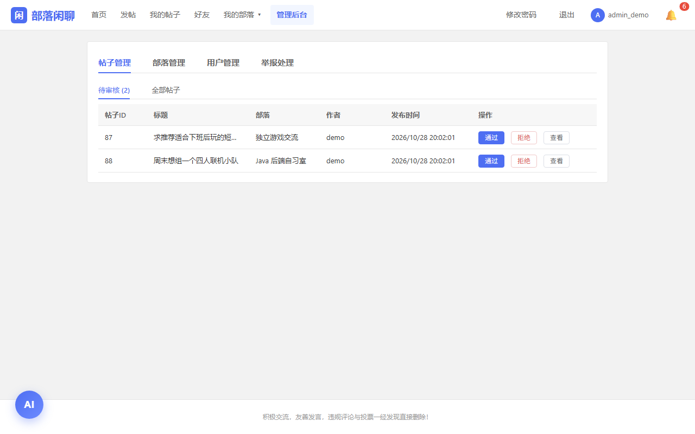

# 部落闲聊 · 兴趣部落社区系统（前端）

Vue 3 前端，对应后端仓库 [buluo-backend](https://github.com/shhowmaker190/buluo-backend)。
按兴趣部落组织内容的社区论坛：发帖、评论、点赞、私聊、好友、签到等级、内容审核与后台管理，共 12 个页面。

## 技术栈

- Vue 3（Composition API）+ Vite
- Vue Router（含登录与管理员守卫）
- Element Plus
- axios（统一拦截器：注入 token、401 清理登录态）
- 原生 `EventSource` 接收 SSE 私聊推送

## 快速开始

```bash
npm install
npm run dev
```

打开 http://localhost:5173 。**需要先启动后端 8080**，否则页面能开但接口全空。

构建生产包：

```bash
npm run build      # 产物在 dist/
```

## 与后端如何联调

前端所有请求走相对路径 `/api`，开发时由 Vite 代理转发到后端：

```js
// vite.config.js
server: {
  proxy: {
    '/api':     { target: 'http://localhost:8080', changeOrigin: true },
    '/uploads': { target: 'http://localhost:8080', changeOrigin: true }
  }
}
```

因此 **浏览器里看不到跨域**，也无需在后端配 CORS。部署到 Nginx 时，同样需要把 `/api` 与 `/uploads` 反代到后端 8080。

## 目录结构

```
src/
├── main.js            入口：创建应用、挂路由、引入 Element Plus
├── App.vue            根组件：路由出口 + 登录弹窗 + 全局样式
├── router/index.js    路由表与全局守卫
├── utils/
│   ├── http.js        axios 实例：baseURL、超时、token 注入、401 处理
│   ├── level.js       用户等级唯一口径（活跃值 → Lv1~Lv6）
│   ├── tribeHeat.js   部落热度等级
│   └── emoji.js       表情数据
├── composables/
│   ├── auth.js        登录态（token / role / userId）
│   └── chat.js        SSE 长连接与未读数
├── views/             12 个页面
└── components/        9 个可复用组件
```

## 页面一览

| 路由 | 页面 | 权限 |
|---|---|---|
| `/home` | 首页（部落、帖子列表） | 游客可浏览 |
| `/post/:id` | 帖子详情 | 需登录 |
| `/create` `/my-posts` | 发帖、我的帖子 | 需登录 |
| `/tribe/create` `/tribe/edit/:id` | 建部落、改部落 | 需登录 |
| `/chat` | 私聊 | 需登录 |
| `/profile` `/user/:id` | 我的主页、他人主页 | 需登录 |
| `/admin` | 后台管理 | 需 `role=ADMIN` |

## 几个实现要点

- **登录态**：token 存 `sessionStorage`，由 axios 请求拦截器统一注入 `Authorization: Bearer`；401 时清空登录态并弹登录框。
- **路由守卫**：`meta.requiresAuth` / `meta.requiresAdmin` 两个标记，在 `beforeEach` 里判断，未登录跳转登录页。
- **等级口径统一**：活跃值 = 已发布帖子×3 + 评论×1 + 签到经验，只在 `utils/level.js` 里算一次，避免各页面显示不一致。
- **实时消息**：`EventSource` 连接 `/api/chat/stream`（token 走 URL 参数，因为 EventSource 不支持自定义 header），断线自动重连。

## 截图

> 截图放在 `docs/screenshots/` 下，然后把下面注释里的表格取消注释。

<!--
| 首页 | 帖子详情 | 后台 |
|---|---|---|
|  |  |  |
-->

## 说明

- 项目为个人学习 / 毕业设计作品，未使用 TypeScript，未写单元测试；
- 组件内样式用 `scoped`，避免与 `App.vue` 的全局类名冲突。
